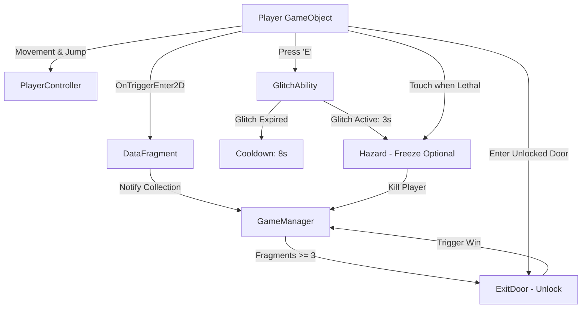

# Script Contracts — GLITCH RUN: BREAK THE SIMULATION

> **Status:** All contracts, signatures, and interfaces defined in this document are **PROPOSED**. They serve as design specifications and guidelines for the team prior to implementation and review. No C# gameplay scripts have been written yet.

---

## Project Overview & Technical Context
- **Project Name:** GLITCH RUN — BREAK THE SIMULATION
- **Genre:** 2D Precision / Puzzle Platformer
- **Target Engine Version:** Unity 6000.6.7f1 (Unity 6)
- **Input System:** Unity New Input System (Package version 1.20.1)
- **Physics Framework:** Unity 2D Physics (`Rigidbody2D`, `Collider2D`)

---

## Summary of Proposed Gameplay Scripts

| Script | Core Responsibility |
| :--- | :--- |
| **`PlayerController.cs`** | Handles player movement, jumping, and ground contact checks. |
| **`GameManager.cs`** | Tracks global state, collected data fragments, level reset, defeat, and victory. |
| **`GlitchAbility.cs`** | Manages the Glitch mechanic (activated via the `E` key, 3s duration, 8s cooldown). |
| **`Hazard.cs`** | Eliminates the player on touch; supports optional freezing during an active Glitch state. |
| **`DataFragment.cs`** | Single-collection pickup item that notifies `GameManager`. |
| **`ExitDoor.cs`** | Exit threshold that remains locked until all three fragments are collected. |

---

## 1. `PlayerController.cs` [PROPOSED]

### Purpose
Provides responsive 2D platformer movement, ground detection, and jump mechanics for the player character using Unity's 2D physics system and the New Input System.

### Required Unity Components
- `Rigidbody2D` (Dynamic, Interpolate: Interpolate, Collision Detection: Continuous recommended)
- `Collider2D` (e.g., `CapsuleCollider2D` or `BoxCollider2D` for body collision)
- `PlayerInput` (from the New Input System package, or read directly via `InputActionAsset` / `Keyboard.current`)

### Inspector References
- `[SerializeField] private float moveSpeed = 8f;` — Horizontal movement speed.
- `[SerializeField] private float jumpForce = 14f;` — Upward vertical velocity applied on jump.
- `[SerializeField] private Transform groundCheckPoint;` — An empty child GameObject positioned at the player's feet.
- `[SerializeField] private float groundCheckRadius = 0.2f;` — Overlap radius for ground collision detection.
- `[SerializeField] private LayerMask groundLayer;` — Layer mask identifying what surfaces count as solid ground.

### Proposed Public Properties & Methods
```csharp
// [PROPOSED INTERFACE]
public class PlayerController : MonoBehaviour
{
    // Properties
    public bool IsGrounded { get; }
    public Vector2 CurrentVelocity { get; }
    public bool CanMove { get; set; }

    // Public Methods
    public void ResetPosition(Vector2 spawnPosition);
    public void DisableMovement();
    public void EnableMovement();
}
```

### Dependencies on Other Scripts
- **`GameManager`**: Reads player state during defeat/respawn scenarios.
- **`GlitchAbility`**: May be attached to the same player GameObject; can optionally modify speed or visual trail while glitching.

### Integration Notes for Teammates
- **Input Handling:** Configure the New Input System action map with a `Move` Vector2 action (WASD / Left Stick / Arrow keys) and a `Jump` Button action (Space / South Button).
- **Physics Tip:** Set `Rigidbody2D.freezeRotation = true` (or check `Freeze Rotation Z` under Constraints in the Inspector) to keep the player character from toppling over.
- **Ground Detection:** Position `groundCheckPoint` slightly below the bottom edge of the player's collider to prevent getting stuck on walls while still reliably detecting floors and platforms.

---

## 2. `GameManager.cs` [PROPOSED]

### Purpose
Serves as the central gameplay orchestrator and state tracker. Manages player life/death cycles, fragment counts, win/loss conditions, and scene reload routines.

### Required Unity Components
- None strictly required on the GameObject itself; typically placed on an empty GameObject named `[GameManager]` in the scene root.

### Inspector References
- `[SerializeField] private int requiredFragments = 3;` — Total fragments required to unlock the exit door (default: 3).
- `[SerializeField] private Transform playerSpawnPoint;` — Transform marking the player's initial/respawn location.
- `[SerializeField] private float respawnDelay = 1.0f;` — Delay before restarting the level upon player death.
- `[SerializeField] private GameObject winUI;` — (Optional UI) HUD element or overlay enabled upon victory.
- `[SerializeField] private GameObject gameOverUI;` — (Optional UI) HUD element or overlay enabled upon death.

### Proposed Public Properties & Methods
```csharp
// [PROPOSED INTERFACE]
public class GameManager : MonoBehaviour
{
    // Singleton Access
    public static GameManager Instance { get; }

    // State Properties
    public int CollectedFragments { get; }
    public int RequiredFragments { get; }
    public bool IsGameWon { get; }
    public bool IsGameOver { get; }

    // Public Events / Callbacks
    public event System.Action<int, int> OnFragmentsUpdated; // (collected, totalRequired)
    public event System.Action OnPlayerDied;
    public event System.Action OnGameWon;

    // Public Methods
    public void RegisterFragmentCollected();
    public void TriggerPlayerDeath();
    public void TriggerVictory();
    public void RestartLevel();
}
```

### Dependencies on Other Scripts
- **`PlayerController`**: Resets or halts the player when death or victory is triggered.
- **`DataFragment`**: Calls `RegisterFragmentCollected()` when picked up.
- **`Hazard`**: Calls `TriggerPlayerDeath()` when an active hazard strikes the player.
- **`ExitDoor`**: Queries `CollectedFragments >= RequiredFragments` to determine if entry is permitted.

### Integration Notes for Teammates
- **Singleton Pattern:** Implement a clean `Instance` accessor with `Awake()` validation. Keep the prototype lightweight: scene reloading via `UnityEngine.SceneManagement.SceneManager.LoadScene` can be used for initial prototypes.
- **UI Decoupling:** Use C# events (`OnFragmentsUpdated`, `OnPlayerDied`, `OnGameWon`) so UI displays can update without hardcoding direct references to every script.

---

## 3. `GlitchAbility.cs` [PROPOSED]

### Purpose
Empowers the player to temporarily "glitch" the simulation by pressing the `E` key. During the 3-second active window, the simulation is destabilized (e.g., hazards can be frozen or bypassed). Afterwards, an 8-second cooldown prevents repeated spamming.

### Required Unity Components
- Attached to the Player GameObject alongside `PlayerController`.
- Requires access to the New Input System (listening for the `Glitch` action mapped to the `E` key).

### Inspector References
- `[SerializeField] private float glitchDuration = 3.0f;` — Time in seconds that the glitch remains active (3.0s).
- `[SerializeField] private float glitchCooldown = 8.0f;` — Time in seconds before the glitch can be re-triggered (8.0s).
- `[SerializeField] private GameObject glitchVFX;` — (Optional) Visual particle effect, screen shader, or chromatic aberration toggle active during the glitch.
- `[SerializeField] private AudioClip glitchActivateSFX;` — (Optional) Audio played upon activation.

### Proposed Public Properties & Methods
```csharp
// [PROPOSED INTERFACE]
public class GlitchAbility : MonoBehaviour
{
    // Properties
    public bool IsGlitchActive { get; }
    public bool IsOnCooldown { get; }
    public float RemainingGlitchTime { get; }
    public float CooldownProgressNormalized { get; } // 0.0f (ready) to 1.0f (just used)

    // Events
    public event System.Action OnGlitchStarted;
    public event System.Action OnGlitchEnded;
    public event System.Action OnCooldownFinished;

    // Public Methods
    public bool TryActivateGlitch();
    public void ResetCooldown();
}
```

### Dependencies on Other Scripts
- **`PlayerController`**: Runs on the same player object; can be queried to verify the player is alive before triggering.
- **`Hazard`**: Hazards listen to or query `GlitchAbility.IsGlitchActive` to determine if their lethal effects or movements should freeze.
- **`GameManager`**: Resets cooldowns when the player dies and the scene or state resets.

### Integration Notes for Teammates
- **Input Binding:** In the New Input System Actions asset, map the `Glitch` action to `<Keyboard>/e` (and gamepad shoulder button / East button if supporting controllers).
- **Timing:** Utilize coroutines or timestamp calculations (`Time.time`) so pause states or `Time.timeScale` changes (if any are introduced later) do not create glitches in cooldown tracking.

---

## 4. `Hazard.cs` [PROPOSED]

### Purpose
Represents lethal obstacles in the simulation (spikes, laser beams, patrolling enemies, digital static). Instantly defeats the player on contact. Features optional freezing behavior during active Glitch periods.

### Required Unity Components
- `Collider2D` (configured with `isTrigger = true` for overlay zones or `isTrigger = false` for physical impassable obstacles with collision callbacks).
- Optional: `Rigidbody2D` (Kinematic) if the hazard moves along a patrol route.

### Inspector References
- `[SerializeField] private bool canBeGlitchFrozen = true;` — If checked, this hazard becomes inert and freezes when a glitch is active.
- `[SerializeField] private Color normalColor = Color.red;` — Visual indicator for active lethal state.
- `[SerializeField] private Color frozenColor = Color.cyan;` — Visual indicator when rendered inert by the glitch.
- `[SerializeField] private SpriteRenderer hazardRenderer;` — Optional reference to tint sprite during frozen states.

### Proposed Public Properties & Methods
```csharp
// [PROPOSED INTERFACE]
public class Hazard : MonoBehaviour
{
    // Properties
    public bool IsFrozen { get; }
    public bool IsLethal { get; }

    // Public Methods
    public void FreezeHazard();
    public void UnfreezeHazard();
}
```

### Dependencies on Other Scripts
- **`GameManager`**: Calls `GameManager.Instance.TriggerPlayerDeath()` when colliding with an active player.
- **`GlitchAbility`**: Subscribes to `OnGlitchStarted` and `OnGlitchEnded` (or checks `IsGlitchActive`) to trigger `FreezeHazard()` / `UnfreezeHazard()`.

### Integration Notes for Teammates
- **Trigger vs Collision:** By convention, use `isTrigger = true` with `OnTriggerEnter2D(Collider2D other)` and check `if (other.CompareTag("Player"))`.
- **Player Tag:** Ensure the player prefab has the `"Player"` tag assigned in the Unity Inspector.
- **Freeze Behavior:** When `canBeGlitchFrozen` is enabled, disable the collider or set `IsLethal = false`, and stop movement or tweening until `UnfreezeHazard()` is called.

---

## 5. `DataFragment.cs` [PROPOSED]

### Purpose
Represents collectible simulation fragments scattered throughout the level. Must be collected exactly once per run. Upon collection, it notifies the `GameManager` and disables/destroys itself to prevent duplicate collection.

### Required Unity Components
- `Collider2D` (configured with `isTrigger = true`)
- Optional: `SpriteRenderer` and/or `Animator` for idle bobbing / spinning visual cues.

### Inspector References
- `[SerializeField] private int fragmentValue = 1;` — Value added towards the goal (default: 1).
- `[SerializeField] private GameObject collectVFX;` — (Optional) Particle effect spawned when collected.
- `[SerializeField] private AudioClip collectSFX;` — (Optional) Sound effect played upon collection.

### Proposed Public Properties & Methods
```csharp
// [PROPOSED INTERFACE]
public class DataFragment : MonoBehaviour
{
    // Properties
    public bool IsCollected { get; }

    // Public Methods
    public void Collect();
}
```

### Dependencies on Other Scripts
- **`GameManager`**: Calls `GameManager.Instance.RegisterFragmentCollected()` when touched by the player.

### Integration Notes for Teammates
- **Preventing Double Collection:** Set an internal `bool hasBeenCollected = false;` flag immediately inside `OnTriggerEnter2D` before executing any sound or destruction logic.
- **Layer Recommendation:** Assign fragments to a dedicated `Collectibles` layer that only checks collisions with the `Player` layer in the Unity Physics 2D collision matrix for optimal performance.

---

## 6. `ExitDoor.cs` [PROPOSED]

### Purpose
Marks the level's objective threshold. Remains visually and functionally locked until the player has successfully gathered all three required Data Fragments. Upon contact with the player while unlocked, triggers the level victory sequence.

### Required Unity Components
- `Collider2D` (configured with `isTrigger = true`)
- `SpriteRenderer` (to display locked vs. unlocked visual state)

### Inspector References
- `[SerializeField] private Sprite lockedSprite;` — Visual representation when door is locked.
- `[SerializeField] private Sprite unlockedSprite;` — Visual representation when all fragments are collected.
- `[SerializeField] private GameObject unlockVFX;` — (Optional) Visual flare effect played upon opening.
- `[SerializeField] private AudioClip doorOpenSFX;` — (Optional) Sound effect played when condition is met.

### Proposed Public Properties & Methods
```csharp
// [PROPOSED INTERFACE]
public class ExitDoor : MonoBehaviour
{
    // Properties
    public bool IsUnlocked { get; }

    // Public Methods
    public void Unlock();
    public void Lock();
    public void TryCompleteLevel();
}
```

### Dependencies on Other Scripts
- **`GameManager`**: Subscribes to `GameManager.Instance.OnFragmentsUpdated` to check when `CollectedFragments >= RequiredFragments` (3), and calls `GameManager.Instance.TriggerVictory()` when the player enters the unlocked door.

### Integration Notes for Teammates
- **Immediate Visual Feedback:** Subscribe to `GameManager.Instance.OnFragmentsUpdated` in `OnEnable()`. When the fragment goal is reached, switch the sprite to `unlockedSprite` and play `unlockVFX` immediately so players know the door is open anywhere on screen.
- **Boundary Safety:** Keep the door's trigger active at all times, but in `OnTriggerEnter2D`, check `if (IsUnlocked && other.CompareTag("Player"))` before calling `TriggerVictory()`.

---

## Communication & Event Flow Diagram [PROPOSED]



---

## Next Steps for the Team
1. **Review:** Team members review the proposed contracts in this document.
2. **Approval:** Agree on public method signatures and event naming conventions.
3. **Implementation:** Create C# script files inside `Assets/Scripts/` implementing these specifications using the New Input System and Unity 6 2D physics.
